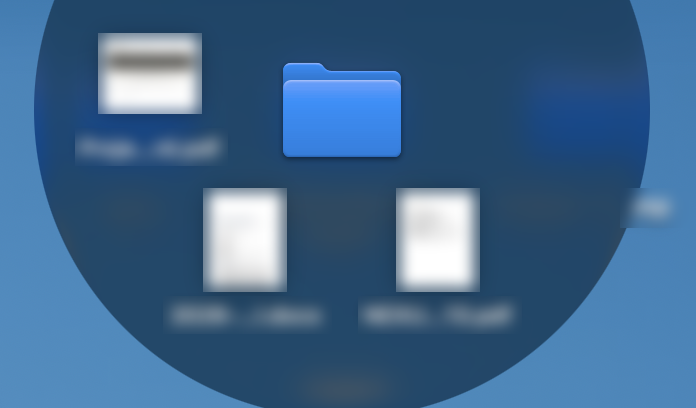

# FolderPeek

Hover over a folder on the Desktop and its files fan out around it in a
Liquid Glass honeycomb. Fully local; macOS 26.

- **Click** a file to open it. Click the folder in the middle to open it in Finder.
- **Drag** a file into a browser, Mail, the terminal, or Finder.
- **Space** over a file previews it (Quick Look). Never while you're typing.
- **+N** shows every file in a grid.

The ring bends away from screen edges and closes when you move away, switch
apps, or switch desktops.

## Build

    ./build.sh             # runs the tests, builds FolderPeek.app
    ./build.sh --install   # also starts it now and at every login
    ./build.sh --uninstall # removes the login item

The first build creates a local signing identity ("FolderPeek Local") so the
Accessibility permission survives rebuilds. Grant it once in System Settings →
Privacy & Security → Accessibility.

Design: `docs/specs/`. Plan: `docs/plans/`.
